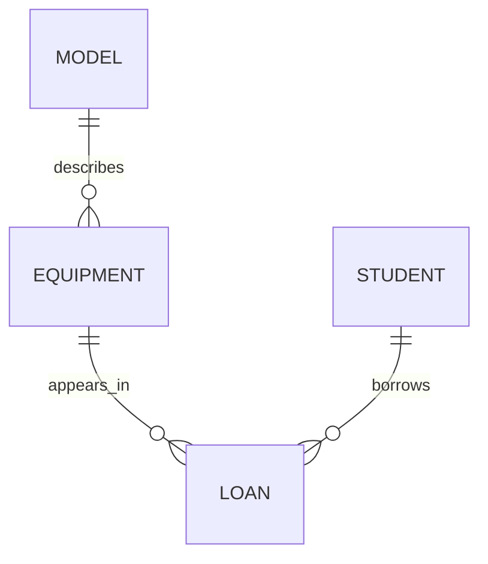

# Campus Equipment Loans

DSC5003 Track 1 project for a campus laboratory. Browse available equipment, check items out and in, and review overdue loans.

## Run locally

Requires Python 3.11 or later. No third-party packages are needed.

```powershell
python app.py --port 8001
```

Open http://127.0.0.1:8001 in a local browser. Keep the terminal open. The default port is 8000. On first launch the app creates a SQLite database and loads fictitious records. The demonstration runs locally and uses a shared screen without accounts. All timestamps are UTC.

## Source files

- `app.py` serves the English interface and handles loan actions.
- `style.css` defines the responsive campus-portal design.
- `db.py` contains parameterized queries, initialization and loan operations.
- `schema.sql` defines the relational schema, constraints and indexes.
- `seed.sql` provides sample data.
- `translate_seed.sql` migrates the original sample data to the English interface.
- `benchmark.py` measures overdue-query performance.
- `../report/report.md` documents the architecture, database design and benchmark evaluation.

## Database design



An equipment model describes several physical items. Each loan references one item and one student. Model descriptions are stored once, and loan status is derived from the due and return timestamps. The documented functional dependencies have superkey determinants, so the relations satisfy BCNF under these dependencies.

Availability uses a NOT EXISTS query. A partial unique index permits at most one open loan per item, including during concurrent checkouts. A separate partial date index supports the overdue range query. Each checkout and return commits in one transaction.

See [../report/report.md](../report/report.md) for the architecture diagram, the ER diagram with keys and relationship cardinalities, and the benchmark results.

## Demonstrate and evaluate

1. Filter by Photography. CAM-01 is initially on loan.
2. Check out CAM-02, find it in the loan records, and check it in.
3. Select Overdue only to see the seeded overdue record.
4. Run `python benchmark.py` to measure indexed queries and concurrent checkouts.

## Extended workflows

`python app.py --port 8001` initializes or upgrades the local database and serves the portal.
Run `python generate_data.py --loans 100000 --output synthetic.sqlite3` to create a
separate reproducible database. Run `python benchmark.py` to regenerate the Section 6 data.

`queries.py` holds the availability, overdue, loan-detail, utilization, model-ranking,
repeat-overdue, overlap, maintenance and audit queries. `translate_seed.sql` is retained
for migration from version 1. Version 3 adds category, maintenance and audit relations.
Existing loan and equipment identifiers are retained. Audit events start at upgrade.

Checkout locks the writer before validating the requested interval and maintenance
state. An open loan has an unknown actual end, and is treated as blocking until
check-in. Intervals use half-open bounds. The partial unique index independently
enforces one open loan per device. Returns and maintenance transitions use the same
writer lock. State changes and audit events commit together. The local portal
supports multiple concurrent requests with a shared operator interface; it does
not authenticate operators or attribute events to individual accounts.

Three additional ER relationships are CATEGORY to MODEL, EQUIPMENT to
MAINTENANCE_LOG, and LOAN or MAINTENANCE_LOG to AUDIT_LOG. A category's name
is its key. Maintenance details depend on their maintenance ID; the equipment and
action target are referenced by foreign key. Derived availability and utilization
are calculated by queries. Referenced rows are protected by RESTRICT on delete,
and identifier changes cascade to dependent rows.

The archived ../report/report.md is the supplied draft. Update it with the version 3 schema,
maintenance and audit workflow, and freshly measured results before submission.

## Performance figures

Run `python benchmark.py` for the four-scale experiment. Install Matplotlib with `python -m pip install matplotlib` and run `python plot_benchmark.py` to regenerate the two PNG figures. See Section 6 of ../report/report.md for the recorded measurements.
