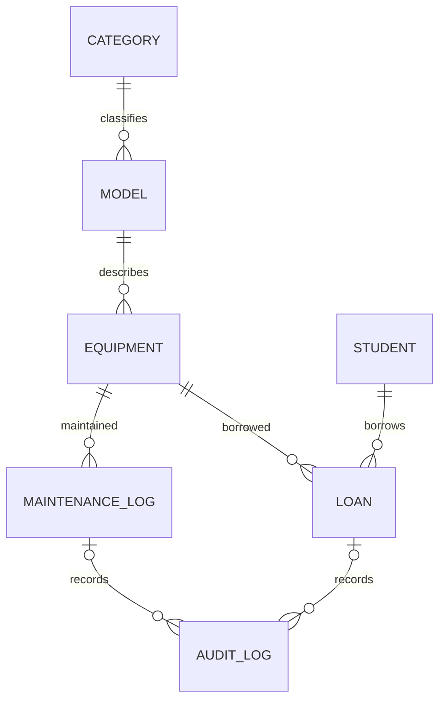

# Campus Equipment Loans — DSC5003 Track 1

A local, shared-operator portal for equipment availability, checkout, return, maintenance and management reports. Python 3.11+ and SQLite are required; no third-party runtime dependencies. Matplotlib is optional for plotting benchmarks.

## Run

From this `code` directory:

```sh
python app.py --port 8001
```

Open http://127.0.0.1:8001. First launch creates `equipment.sqlite3` with fictitious seed data. Existing version 1–3 databases are upgraded to version 4; back up existing data first. Version 4 rejects migration if conflicting open loans and maintenance already exist. Timestamps are UTC.

## Files

| File | Purpose |
|---|---|
| app.py, style.css | HTTP portal and styling |
| db.py | Connections, migrations, transactional operations |
| schema.sql | Seven tables, constraints, six indexes and four triggers |
| seed.sql, translate_seed.sql | Demo data and legacy translation |
| queries.py | Availability, loan history, maintenance and management queries |
| generate_data.py | Synthetic workload generation |
| benchmark.py | Overdue, borrower-history and concurrent checkout latency |
| plot_benchmark.py | Recreate performance charts |
| test_integrity.py | Automated integrity and concurrency tests |
| ../evaluation/ | Recorded metrics, plans, environment, charts and correctness logs |
| ../../DSC5003_Track1_Report/5003-report.pdf | Report (in the complete project archive) |

## Database design



Each audit row references exactly one of a loan or maintenance record. Partial unique indexes enforce one open loan and one open maintenance record per item. Four triggers prevent simultaneous open loan and maintenance states on insert and update. Application checks run inside BEGIN IMMEDIATE transactions; state transitions and audit events commit together. Status is derived from timestamps rather than stored separately.

## Demonstration

Filter Photography, check out CAM-02, check it back in, then open and close maintenance. Attempt checkout while maintenance is open. Use Overdue only to find the seeded overdue loan. Review utilization, popular models, repeated overdue borrowers and audit events. The loan list displays at most 100 records; full history is not exposed through pagination.

## Tests and benchmark reproduction

```sh
python test_integrity.py
python generate_data.py --loans 100000 --output synthetic.sqlite3
python benchmark.py
python -m pip install matplotlib
python plot_benchmark.py
```

The benchmark writes metrics.csv, plans.json and environment.json under ../evaluation; back up recorded results before rerunning. The standalone data generator creates a separate database with 1,000 open loans; the benchmark reduces this to 100 open loans (10 overdue). The archived performance results were collected on the original version 3 schema; new version 4 timings can differ. The correctness log is from version 4.

## Limitations

Local use only: no authentication or operator attribution. Synthetic workloads, fixed active-loan count, one borrower-history target, and 1/4 writers do not represent all production workloads. The benchmarks measure database latency, not HTTP throughput. Direct SQL operations are constrained but do not automatically create audit events.
