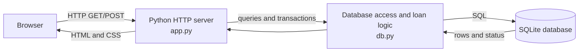
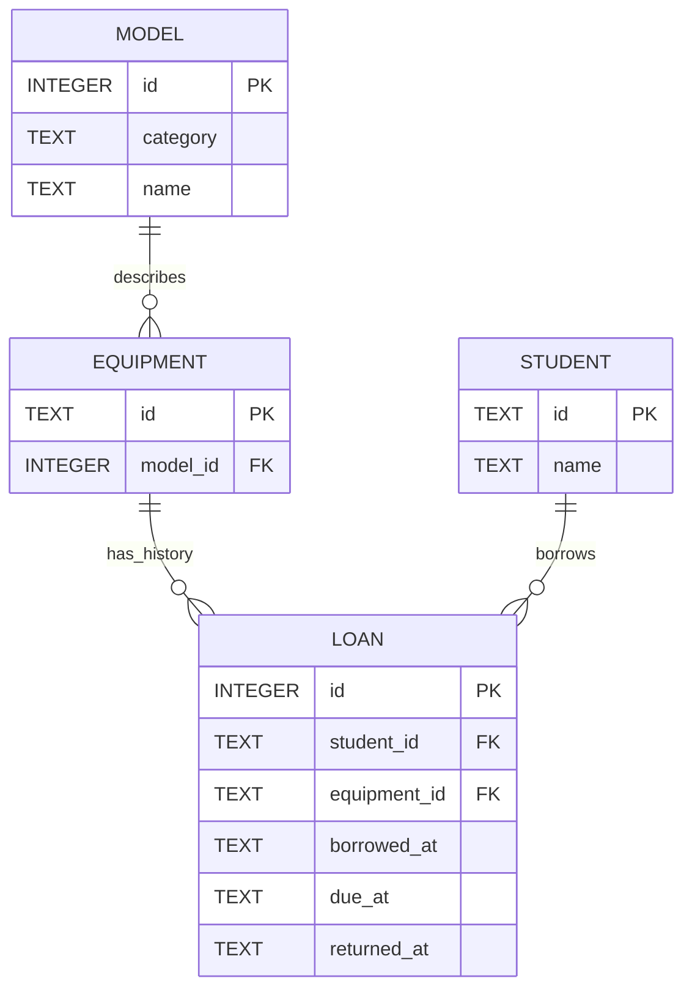
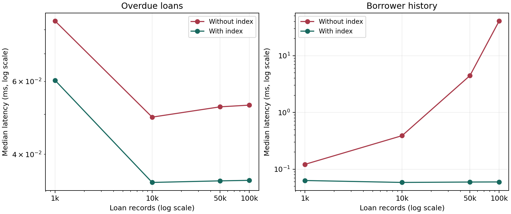
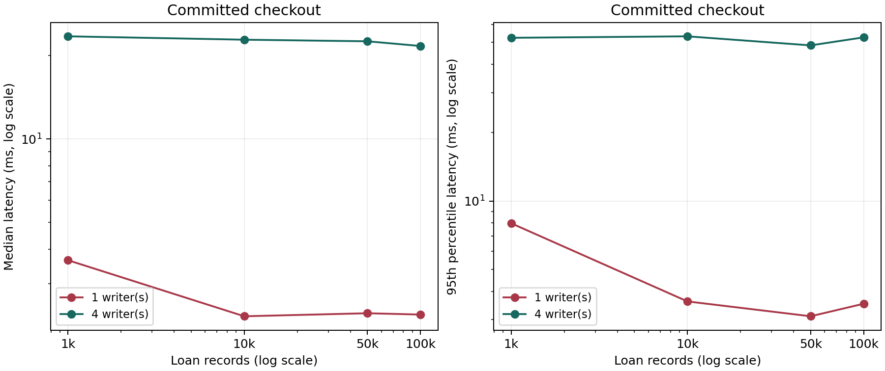

# Campus Equipment Loans — System and Database Report

## System overview

The application lets users browse equipment, check items out and in, and review overdue loans. It uses Python's standard-library HTTP server and SQLite, so the demonstration has no third-party runtime dependencies.

## System architecture



The browser sends page requests and loan actions to `app.py`. The server renders the interface and delegates database work to `db.py`, which uses SQLite transactions and parameterized SQL. The database is stored locally in `equipment.sqlite3`.

## Relational design



Each equipment item references exactly one model; a model can describe zero or more equipment items. Each loan references exactly one student and one equipment item. A student or an equipment item can have zero or more loan records over time. The primary keys identify each row; the foreign keys enforce the model, borrower and equipment relationships. `(category, name)` is also unique for models.

Availability is determined by the absence of an open loan for an item:

```sql
SELECT e.id, m.name, m.category
FROM equipment AS e
JOIN model AS m ON m.id = e.model_id
WHERE NOT EXISTS (
    SELECT 1
    FROM loan AS l
    WHERE l.equipment_id = e.id
      AND l.returned_at IS NULL
);
```

`returned_at IS NULL` identifies an open loan. The query returns an item only when no such loan exists. The database also enforces this rule against concurrent checkout attempts with a partial unique index:

```sql
CREATE UNIQUE INDEX one_open_loan
    ON loan(equipment_id)
    WHERE returned_at IS NULL;
```

The index makes a second open loan for the same equipment item fail even if two requests check availability at nearly the same time. A second partial index supports overdue searches:

```sql
CREATE INDEX open_loan_due
    ON loan(due_at)
    WHERE returned_at IS NULL;
```

## 6. Evaluation and results

We measured two read queries and the application's checkout transaction on temporary, file-backed databases with exactly 1,000, 10,000, 50,000 and 100,000 loans. Each database contains 500 synthetic borrowers, 1,000 inventory items and four dedicated checkout targets. At all scales 100 loans are open and ten are overdue at the fixed UTC cutoff of 1 February 2026. Historical loans increase while the open workload stays constant. Seed 5003 fixes borrower assignments.

Environment: Windows-11-10.0.26200-SP0; Intel64 Family 6 Model 170 Stepping 4, GenuineIntel; Python 3.14.0; SQLite 3.50.4; journal mode delete; synchronous setting 2. Data generation, index construction and connection setup are outside the timed intervals.

### Read latency and query plans

Each query runs first without its candidate index, then with it on the same data. All other production indexes, including uniqueness constraints, stay enabled. After ANALYZE and ten warmup executions, each timed sample covers execution and fetching the result. We report the median of 100 samples and verify equivalent results. The overdue query sorts open, overdue loans by due time. The history query joins models and equipment and retrieves at most the latest 20 loans for one fixed borrower.

| Loan rows | Query | Result rows | Without index (ms) | With index (ms) | Speedup |
|---:|---|---:|---:|---:|---:|
| 1,000 | Overdue loans | 10 | 0.0840 | 0.0604 | 1.39x |
| 1,000 | Borrower history | 2 | 0.1218 | 0.0633 | 1.92x |
| 10,000 | Overdue loans | 10 | 0.0492 | 0.0342 | 1.44x |
| 10,000 | Borrower history | 20 | 0.3898 | 0.0586 | 6.66x |
| 50,000 | Overdue loans | 10 | 0.0521 | 0.0345 | 1.51x |
| 50,000 | Borrower history | 20 | 4.4490 | 0.0595 | 74.77x |
| 100,000 | Overdue loans | 10 | 0.0526 | 0.0346 | 1.52x |
| 100,000 | Borrower history | 20 | 40.8086 | 0.0597 | 682.99x |



At 100,000 loans SQLite reported these plans:

**Overdue loans / Without index**

```text
SCAN loan USING INDEX one_open_loan
USE TEMP B-TREE FOR ORDER BY
```

**Overdue loans / With index**

```text
SEARCH loan USING INDEX open_loan_due (due_at<?)
```

**Borrower history / Without index**

```text
SCAN m
SCAN e
SEARCH l USING INDEX loan_equipment_history (equipment_id=?)
USE TEMP B-TREE FOR ORDER BY
```

**Borrower history / With index**

```text
SEARCH l USING INDEX loan_student_history (student_id=?)
SCAN m
SEARCH e USING COVERING INDEX equipment_by_model (model_id=? AND id=?)
```

The overdue baseline can scan the partial uniqueness index containing only the 100 open loans. Its cost therefore has limited sensitivity to archived loans. The due-date index can narrow that scan to a range and supply the requested order. Borrower history exercises a different access pattern: the student-and-time index locates one borrower's recent records in order. The LIMIT bounds the number fetched. Full plans for every scale are in [plans.json](../evaluation/plans.json).

### Concurrent checkout latency

One or four synchronized clients use independent SQLite connections. Each issues a real checkout on a distinct item through the application's transaction function; timing includes waiting for the write lock, validation, loan and audit insertion, and commit. Verification and fixture cleanup occur after each batch, restoring the original row count. Single-client runs use ten warmup batches and 100 measured batches. Four-client runs use three warmup batches and 25 measured batches, yielding 100 committed checkout samples per condition.

| Loans | Writers | Committed samples | Median (ms) | P95 (ms) |
|---:|---:|---:|---:|---:|
| 1,000 | 1 | 100 | 3.645 | 7.977 |
| 1,000 | 4 | 100 | 23.481 | 52.399 |
| 10,000 | 1 | 100 | 2.287 | 3.611 |
| 10,000 | 4 | 100 | 22.832 | 53.182 |
| 50,000 | 1 | 100 | 2.345 | 3.107 |
| 50,000 | 4 | 100 | 22.529 | 48.514 |
| 100,000 | 1 | 100 | 2.320 | 3.528 |
| 100,000 | 4 | 100 | 21.668 | 52.635 |



At 100,000 rows the four-client P95 was 52.63 ms, compared with 3.53 ms for one client. SQLite serializes writers even when they modify distinct items. The measurements include scheduling and commit I/O. The four-client curve measures database-level writer contention; it does not estimate HTTP latency or a same-item rejection rate.

### Reproducibility and scope

Run `python benchmark.py` and then `python plot_benchmark.py` (Matplotlib required only for plotting). [metrics.csv](../evaluation/metrics.csv) includes result counts, medians, inclusive quartiles and P95. [environment.json](../evaluation/environment.json) records the runtime. The run uses warmed reads, a fixed open-loan population, one machine and a fixed configuration order. Filesystem cache and scheduler variability can affect these measurements.
